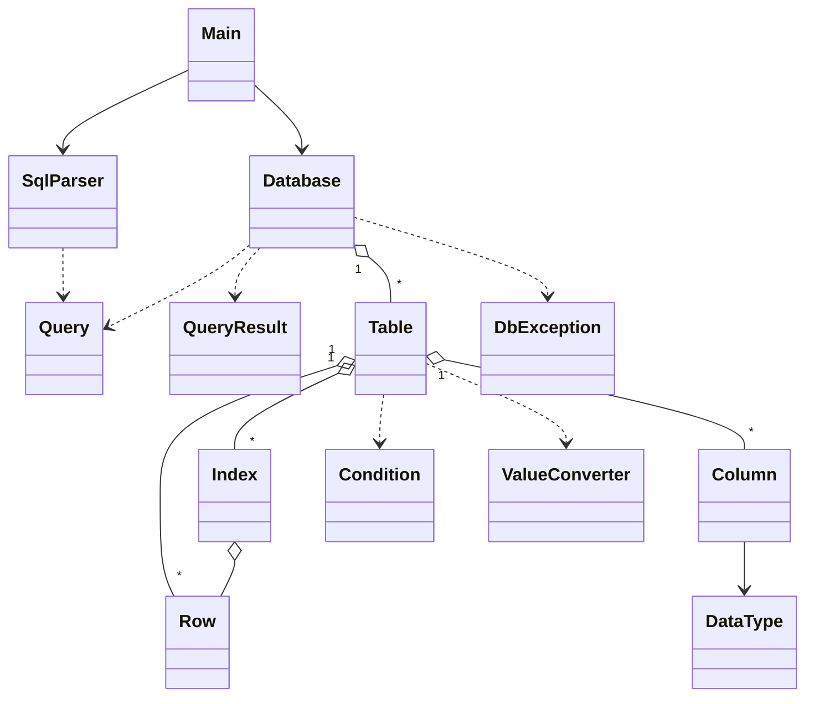
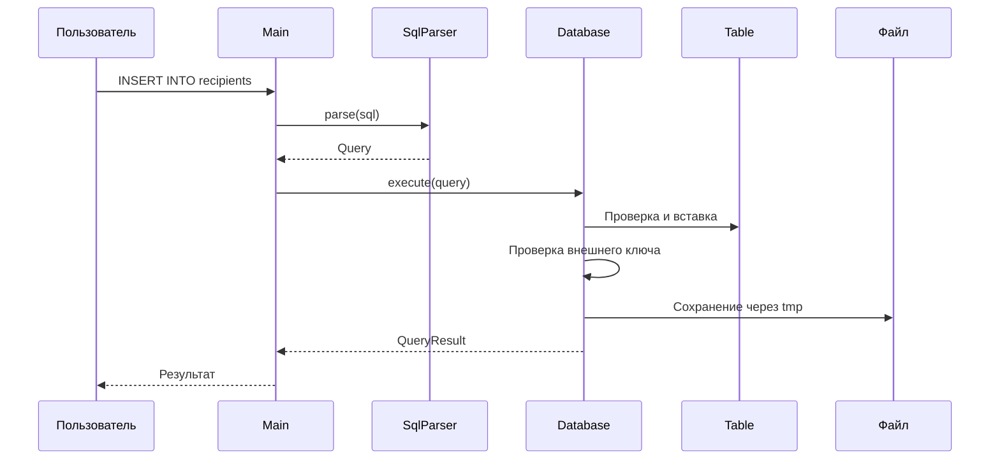
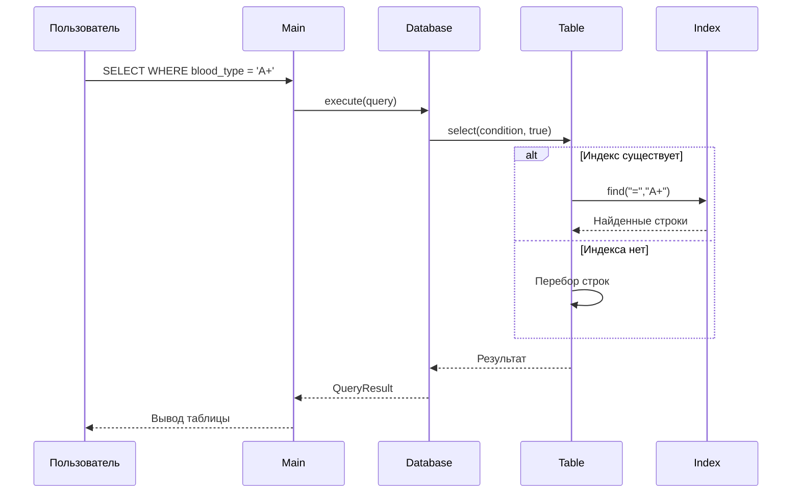

# Мини-СУБД на Java: доноры и реципиенты

Лабораторная работа по созданию упрощённой системы управления базами данных на Java.

В проекте я реализовала две связанные таблицы: `donors` и `recipients`. Данные сохраняются в файлах, для работы с ними используется собственный парсер SQL-подобных запросов. Также реализованы индексы для ускорения поиска.

## 1. Структура базы данных

**donors**

| Столбец | Тип | Ограничение |
|---|---|---|
| donor_id | INT | PRIMARY KEY |
| full_name | STRING | NOT NULL |
| blood_type | STRING | NOT NULL |
| weight_kg | DOUBLE | NULL |

**recipients**

| Столбец | Тип | Ограничение |
|---|---|---|
| recipient_id | INT | PRIMARY KEY |
| full_name | STRING | NOT NULL |
| blood_type | STRING | NOT NULL |
| donor_id | INT | FOREIGN KEY |
| request_date | DATE | NOT NULL |
| urgent | BOOLEAN | NOT NULL |

Таблицы создаются автоматически при первом запуске. `recipients.donor_id` ссылается на `donors.donor_id`.

## 2. Возможности программы

- Типы данных: INT, DOUBLE, STRING, DATE, BOOLEAN.
- SQL-команды: INSERT, SELECT, UPDATE, DELETE, CREATE INDEX, SHOW TABLES.
- Пакетная вставка нескольких записей.
- Проверка уникальности первичных ключей и внешних связей.
- Сохранение таблиц и индексов на диск с восстановлением при запуске.
- Обработка ошибок ввода без аварийного завершения программы.
- Автоматическое создание индекса по первичному ключу.

`CREATE TABLE` и `DROP TABLE` пока не реализованы.

## 3. Архитектура проекта

Исходный код находится в `src/`. Каждый класс расположен в отдельном файле.

| Класс | Назначение |
|---|---|
| Main | Консольный интерфейс |
| SqlParser | Разбор SQL-запросов |
| Query, QueryResult | Хранение запроса и результата |
| Database | Управление таблицами и сохранением данных |
| Table | Операции со строками и столбцами |
| Index | Индексы на основе TreeMap |
| Row, Column, DataType | Структура данных |
| Condition | Проверка WHERE |
| ValueConverter | Преобразование и проверка типов |
| DbException | Обработка ошибок базы данных |
| PerformanceTest | Тест производительности |

Ввод и вывод находятся только в `Main`. Остальные классы занимаются обработкой данных и не работают с консолью.

### Диаграмма классов



### Диаграмма последовательности: добавление записи



### Диаграмма последовательности: поиск по индексу



## 4. Индексы и сохранение данных

Для индексов используется `TreeMap`, где ключом является значение столбца, а значением — список соответствующих строк.

Поддерживаются операторы `=`, `<`, `>`, `<=`, `>=`. Для `!=` выполняется обычный перебор.

Индекс по первичному ключу создаётся автоматически. Остальные индексы можно создавать командой `CREATE INDEX`.

При изменении таблицы данные записываются во временный файл `.tmp`, который после успешной записи заменяет основной `.tbl`. Это позволяет сохранить предыдущую версию файла при прерывании записи.

При запуске программа восстанавливает таблицы и индексы. Незавершённые временные файлы удаляются, повреждённые файлы пропускаются с предупреждением.

## 5. Запуск программы

Требуется JDK 8 или новее.

Откройте терминал в корневой папке проекта.

**Компиляция:**

```bash
javac -encoding UTF-8 -d out src/*.java
```

**Запуск:**

```bash
java -cp out Main
```

Кодировка UTF-8 настраивается самой программой.

После запуска доступны команды:

| Команда | Назначение |
|---|---|
| `help` | Справка |
| `run demo.sql` | Запуск SQL-файла |
| `exit` | Выход |

Файлы базы создаются в папке `data/` относительно текущей рабочей директории. Для очистки базы достаточно удалить эту папку.

## 6. Примеры запросов

```sql
-- Добавление записей
INSERT INTO donors VALUES (1, 'Иванов Иван', 'A+', 82.5);

INSERT INTO donors VALUES
(2, 'Петрова Анна', 'O-', 65.0),
(3, 'Сидоров Пётр', 'B+', 90.3);

INSERT INTO recipients VALUES
(1, 'Смирнов Алексей', 'A+', 1, '2026-11-01', TRUE);

-- Выборка
SELECT * FROM donors;
SELECT full_name, weight_kg FROM donors WHERE weight_kg > 70;

-- Изменение и удаление
UPDATE donors SET weight_kg = 85 WHERE donor_id = 1;
DELETE FROM recipients WHERE recipient_id = 1;

-- Индекс и информация о таблицах
CREATE INDEX idx_donors_blood ON donors (blood_type);
SHOW TABLES;
```

Строки записываются в одинарных кавычках, даты — в формате `ГГГГ-ММ-ДД`, логические значения — `TRUE` или `FALSE`. Для пустых значений используется `NULL`.

Условия WHERE поддерживают `=`, `!=`, `<`, `>`, `<=`, `>=`.

Для проверки ошибок предусмотрен файл `err_test.sql` с более чем двадцатью тестовыми запросами. Перед его запуском рекомендуется выполнить `demo.sql`.

**Пример обработки ошибок:**

```text
sql> INSERT INTO donors VALUES (abc, 'X', 'A+', 70.0);
Ошибка: 'abc' не целое число

sql> INSERT INTO recipients VALUES (9, 'Нет донора', 'A+', 99, '2026-11-01', TRUE);
Ошибка: Нарушен внешний ключ
```

## 7. Тест производительности

Для проверки индексов я написала отдельный класс `PerformanceTest`. Он создаёт временную базу с разным количеством записей и сравнивает поиск с индексом и без него.

Каждый запрос выполняется 200 раз. Дополнительно проверяется, что оба способа поиска возвращают одинаковое количество строк.

**Окружение:** Windows, PowerShell, Eclipse Temurin JDK 21.

Запуск:

```bash
java -cp out PerformanceTest
```

Результаты моего тестирования (время в микросекундах на один запрос):

| Количество строк | Условие | Без индекса | С индексом | Ускорение |
|---:|---|---:|---:|---:|
| 1 000 | full_name = 'Donor 500' | 36 | 22 | 1,6 раза |
| 10 000 | blood_type = 'A+' | 114 | 2 | 57 раз |
| 50 000 | full_name = 'Donor 25000' | 734 | 2 | 367 раз |
| 100 000 | weight_kg > 109.5 | 1 271 | 5 | 254 раза |
| 100 000 | blood_type = 'A+' | 1 644 | 15 | 110 раз |

Результаты показывают, что при увеличении таблицы индексы заметно ускоряют поиск. Значения зависят от компьютера и работы JVM. Время меньше одной микросекунды может отображаться как `<1`.

## 8. Выводы

В этой лабораторной работе я реализовала упрощённую СУБД на Java с двумя связанными таблицами. Разобралась с сериализацией данных, обработкой запросов, проверкой ключей и созданием индексов.

Отдельно я проверила, как индексы влияют на скорость поиска. Тесты показали, что на больших таблицах разница между обычным перебором и поиском через индекс может быть очень существенной.

## 9. Источники

1. Oracle. Java SE 8 API Documentation. https://docs.oracle.com/javase/8/docs/api/
2. Oracle. The Java Tutorials. https://docs.oracle.com/javase/tutorial/
3. Bloch J. Effective Java. 3rd ed. Addison-Wesley, 2018.
4. Horstmann C. Core Java, Volume I. Fundamentals.
5. Garcia-Molina H., Ullman J., Widom J. Database Systems: The Complete Book.
6. Материалы лекций по Java.
